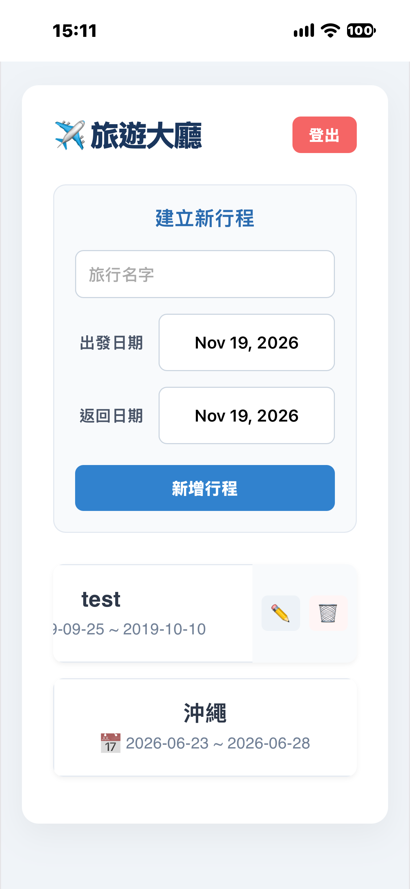
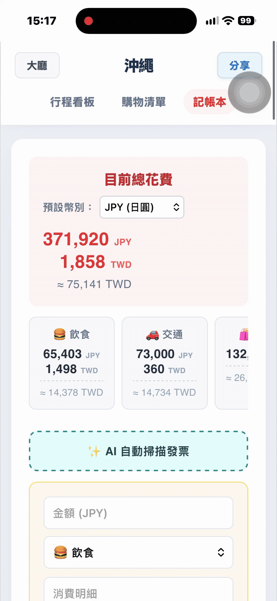

# Travel Planner｜旅遊行程與記帳管理系統

一個結合旅遊行程規劃與費用管理的全端 Web 應用程式，提供使用者集中安排每日旅遊景點、調整行程順序，以及記錄旅遊支出的功能。

## 專案背景

規劃旅遊時，行程安排與費用紀錄通常分散在不同工具中。當旅遊天數增加，或需要與其他人共同規劃時，容易產生資訊分散、行程修改不便及費用難以統整等問題。

因此，我規劃並開發 Travel Planner，將行程管理與旅遊記帳整合至同一個系統，並採用前後端分離架構，讓功能與系統維護更具彈性。

## 核心功能

- **每日行程管理**：依照旅遊日期分類與管理景點。
- **拖曳式行程排序**：透過 Drag and Drop 調整景點順序。
- **跨日期行程移動**：支援將景點拖曳至不同日期，快速調整旅遊安排。
- **旅遊費用管理**：提供旅遊支出紀錄與管理功能。
- **邀請碼註冊機制**：透過邀請碼控管使用者註冊。
- **API 存取驗證**：在處理資料庫請求前進行環境金鑰驗證，降低未授權存取與自動化惡意註冊的風險。
- **響應式介面**：支援不同尺寸的裝置畫面。

## 系統架構

本專案採用前後端分離架構：

```text
             使用者瀏覽器
                   │
                   ▼
            Nginx Reverse Proxy
                   │
          ┌────────┴────────┐
          │                 │
          ▼                 ▼
     React Frontend     Flask API
          │                 │
          │                 ▼
          │            SQLAlchemy
          │                 │
          │                 ▼
          │             PostgreSQL
          │
          ▼
    使用者操作介面
```

### 部署架構

- **Frontend**：React 建置前端介面，透過 Nginx 提供靜態檔案服務。
- **Backend**：Flask 提供 API，使用 Gunicorn 作為應用程式執行服務。
- **Reverse Proxy**：透過 Nginx 處理前端與後端 API 請求。
- **Database**：使用 PostgreSQL 儲存系統資料。
- **Infrastructure**：部署於 OCI Ubuntu Linux 主機。

### Socket.IO 執行設定

`SOCKETIO_ASYNC_MODE` 預設為 `threading`，供本機開發及 CI 使用；正式環境的 Gevent worker 必須設定為 `gevent`。可用值另包含 `eventlet`，但不得讓 worker 類型與模式不一致。`.env.example` 列出其餘必要環境變數；密鑰與資料庫連線資訊應由各環境安全提供。

正式部署使用 Ubuntu / Python 3.10 虛擬環境，安裝 `pip install -r requirements-prod.txt`。此檔引用基本依賴並另外指定 Gunicorn、gevent、gevent-websocket；開發測試依賴則使用 `requirements-dev.txt`。Eventlet 目前保留。

`travel.service` 未來應在 `[Service]` 中加入 `Environment=SOCKETIO_ASYNC_MODE=gevent`，並使用該虛擬環境中的 Gunicorn，例如：

```ini
Environment=SOCKETIO_ASYNC_MODE=gevent
Environment=ALLOWED_ORIGINS=https://bobo-travel-planner.duckdns.org
ExecStart=/path/to/venv/bin/gunicorn -k websocket_worker.OriginCheckedGeventWorker -w 1 -b 127.0.0.1:5001 app:app
```

請依實際路徑與既有 service 設定調整，並確保 Nginx 代理 `/socket.io/` 的 WebSocket upgrade。Gunicorn 的 Socket.IO 部署應維持單 worker；多程序擴充需要相容的負載平衡、sticky sessions 與共享訊息佇列。

### 瀏覽器來源設定

`ALLOWED_ORIGINS` 以逗號分隔完整的 HTTP／HTTPS origin，例如本機 `http://localhost:5173,http://127.0.0.1:5173`；正式同源服務則設定 `https://bobo-travel-planner.duckdns.org`。不包含路徑、尾端斜線、帳密、query 或 fragment，也不接受 `*` 或 `null`。未設定或空白時，不允許任何帶 Origin 的跨來源請求；無效設定會使應用程式啟動失敗。沒有 Origin 的非瀏覽器客戶端仍須通過 JWT 與行程授權。CORS 並非身分驗證或 API 存取控制。

REST 與 Socket.IO 使用相同的精確 allowlist；瀏覽器的 Origin 必須包含在設定中，包括正式 HTTPS 同源網址。REST 使用 Authorization bearer token，不啟用跨來源 cookie credentials。`gevent-websocket` 原生 worker 在執行 Flask 前就送出 HTTP 101，因此部署必須使用上述 `OriginCheckedGeventWorker`，才能在 WebSocket 升級前拒絕不允許的 Origin；它讀取實際 Flask app 的 `ALLOWED_ORIGINS`，未能取得設定時採拒絕策略。變更後重啟服務前，應確認實際 Nginx 設定會轉送原始 `Host`、正確的 `X-Forwarded-Proto` 與 `/socket.io/` 的 Upgrade／Connection headers，並確認公開網址與 allowlist 完全相符。現有程式未啟用 ProxyFix；不要直接信任來自公網的 forwarded headers，若日後需要 ProxyFix，須先確認代理拓撲並限制可信代理數量與直接存取。上述正式 Nginx 設定尚未在本機驗證。

## 技術架構

| 項目 | 使用技術 |
|---|---|
| 前端 | React、Vite |
| 拖曳互動 | @hello-pangea/dnd |
| 後端 | Python、Flask |
| ORM | SQLAlchemy |
| 資料庫 | PostgreSQL |
| Web Server | Nginx |
| Application Server | Gunicorn |
| 部署環境 | OCI、Ubuntu Linux |

## 開發重點

### 1. 前後端分離架構

將使用者介面與後端 API 分開開發，前端負責行程及費用管理的互動操作，後端負責資料處理與 API 邏輯，讓系統功能具有更清楚的分工。

### 2. 拖曳式行程管理

使用 `@hello-pangea/dnd` 實作拖曳互動，讓使用者能夠直接調整同一天的景點順序，也能將景點移動至其他日期，提升行程編排的操作效率。

### 3. 使用者註冊與 API 存取控管

設計邀請碼註冊機制，並在後端 API 處理資料庫請求前進行環境金鑰驗證，增加系統的存取控管，降低未授權操作與自動化註冊的風險。

### 4. 資料庫架構調整

將原本用於測試的輕量型資料庫遷移至 PostgreSQL，以支援正式部署環境中的資料管理及多使用者使用情境。

### 5. Linux 雲端部署

將系統部署至 OCI Ubuntu 主機，使用 Nginx 提供前端靜態檔案服務及反向代理，並透過 Gunicorn 執行 Flask 後端服務，完成前後端與資料庫的部署整合。

## 專案畫面

### 旅遊行程頁面



### 拖曳調整行程


### 旅遊費用管理



## 專案開發方式

本專案由我負責需求規劃、系統功能拆解、前後端整合與部署流程，並運用 AI 協助開發及迭代。

開發過程中，從行程拖曳互動、資料庫架構調整，到 Linux 主機部署與 Nginx 反向代理，逐步完成具備實際使用情境的全端應用程式。

## 健康檢查（供未來 CD 使用）

- `GET /api/health` 是 liveness check，不需 JWT，也不會連資料庫或外部服務；正常回傳 `200 {"status":"ok"}`。
- `GET /api/ready` 是 readiness check，不需 JWT；以唯讀 `SELECT 1` 探測資料庫連線與基本查詢。成功回傳 `200 {"status":"ready","database":"ok"}`；連線或查詢失敗時回傳 `503 {"status":"not_ready","database":"unavailable"}`。

PostgreSQL 的連線逾時及交易內查詢逾時預設皆為五秒，可用 `HEALTH_CHECK_TIMEOUT_SECONDS`（大於 0 且至多 30）調整。

本機驗證：

```bash
curl -i http://127.0.0.1:5001/api/health
curl -i http://127.0.0.1:5001/api/ready
```

未來 CD 可在程序啟動後輪詢 `/api/health`，再以 `/api/ready` 的 200 作為導流前提；503 應保留或重試。`SELECT 1` 只能確認當下資料庫可執行極小的唯讀 SQL，不能保證所有資料表、遷移狀態、權限、資料內容、外部服務或業務功能正常。

## 建立部署產物

安裝 Git、Node.js 和 npm 後，在專案目錄執行：

```bash
python scripts/package_release.py --ref HEAD --output-dir artifacts
cd artifacts
sha256sum -c travel-app-完整CommitSHA.tar.gz.sha256
```

腳本將 ref 固定解析為 Commit，使用 `git archive` 匯出該版本，在隔離目錄執行 `npm ci` 和 `npm run build`，並將建置程序的 `VITE_API_URL` 設為空字串。未提交的修改不會進入產物。輸出只含後端必要檔案、完整 SHA 的 `REVISION` 與前端 `dist/`，並在封裝前後驗證內容；已存在的同名檔案不會覆蓋。

`dist/` 僅允許 HTML、JavaScript、CSS、SVG、常見圖片及字型等指定副檔名，且不允許隱藏項目或敏感目錄。加入其他靜態資源格式時可能需要更新 `scripts/package_release.py` 的允許清單。檔名及副檔名檢查無法保證檔案內容不含秘密資訊。

壓縮檔及校驗檔無法同時原子發布：若發布第二個檔案失敗，程式會移除本次發布的第一個檔案；若程序或系統在兩次操作之間突然終止，仍可能留下單獨的檔案。遇到這種情況請先人工檢查並移除不完整的一組後再重試。輸出目錄須支援同一檔案系統的 hard link。此腳本只建立產物，不執行部署。

### 伺服器端 Artifact Validator

未來的解壓縮流程前，先在伺服器上驗證上傳產物：

```bash
python scripts/validate_artifact.py \
  --artifact /opt/travel-app/incoming/artifact.tar.gz \
  --revision COMMIT_SHA \
  --sha256 SHA256
```

`COMMIT_SHA` 必須是 40 位小寫十六進位 Commit SHA，`SHA256` 必須是 64 位小寫十六進位摘要。成功時會輸出 `VALIDATION_OK`、revision、摘要、檔案數與未壓縮內容大小；任何拒絕情況均寫入安全的 stderr 訊息並以非零狀態結束。

Validator 是只使用 Python 3.10 以上標準函式庫的獨立腳本。它在 Linux 使用不跟隨最終 symbolic link 的方式開啟來源，拒絕非一般檔案或 hard link，將資料與 SHA256 串流寫入有容量限制的私有快照，並只驗證該快照；不會解壓縮到磁碟，也不會執行 Archive 中任何內容。它僅接受 `scripts/package_release.py` 目前產生的格式：必要後端檔案與 `dist/` 內允許的靜態資源。

限制為：壓縮來源 10 MiB、檔案內容總和 50 MiB、單一檔案 20 MiB、最多 1,000 個 member、路徑最多 512 UTF-8 bytes 與 16 層。完整解壓縮資料流（包含 tar metadata、PAX header 與 padding）另限制為 60 MiB。連結、sparse/特殊 member、路徑穿越、隱藏或敏感 `dist/` 項目、重複或大小寫衝突路徑、損壞 gzip/tar 與 gzip 尾端額外資料都會被拒絕。

SHA256 只證明讀取到的位元組符合提供的摘要，**不驗證發布者身分**。驗證也不會鎖定原始路徑，來源檔案在成功後仍可能被替換；未來部署流程必須對即將解壓縮的同一檔案安全開啟並重新驗證，不能僅信任先前驗證結果。

執行時應使用非 root 帳號，並確保來源檔案的所有父目錄由受信任的管理者控制：`O_NOFOLLOW` 只保護最終路徑元件，不保護可被替換的父目錄。Linux 也使用 `O_NONBLOCK` 避免來源被替換成 FIFO 時開啟阻塞。Validator 逐一檢查 tar 的實體 header、兩個結束零區塊與後續零填充，並限制最多 2,000 個實體 header 及每個 PAX metadata 16 KiB；PAX 僅允許打包所需的 `path` 和 `mtime`。60 MiB 解壓縮資料流限制並不等於程序記憶體上限；正式入口仍須另設執行時間與適當的程序資源限制。

### 安全解壓縮至 staging

```bash
python scripts/extract_artifact.py --artifact /opt/travel-app/incoming/artifact.tar.gz \
  --revision COMMIT_SHA --sha256 SHA256 --staging-dir /opt/travel-app/staging
```

staging 必須預先存在，路徑各層不得是 symbolic link 或 reparse point；Linux 上 staging 必須由有效 UID 擁有，且不允許 group 或 other 存取（正式部署預期 700），不符合時拒絕，不自動更改權限或擁有者。父目錄、執行帳號與同 UID 的其他程序均須受信任：路徑檢查無法消除所有父目錄替換競態，也不防禦任意同 UID 程序。Linux 禁止 root 執行；Windows 依賴受信任的 ACL，工具不修改 ACL。此工具以 Validator 的私有快照完成驗證與解壓縮，兩次使用相同解析及限制，並逐檔核對內容摘要。它在 staging 建立獨立暫存目錄，不採用封存的權限或擁有者，Linux 目錄為 700、檔案為 600；Windows 權限由 ACL 決定，chmod 並不等同 ACL。暫存目錄不是完整安全沙箱。

驗證和寫入完成後，Linux 使用 `renameat2(RENAME_NOREPLACE)` 原子發布為完整 SHA 目錄，Windows 使用不覆寫目標的 rename；不支援的平台或 Linux 核心／檔案系統會安全失敗。並行執行同一版本時只有一個可發布，不會覆寫現有版本。一般失敗會清理本次暫存目錄，但 SIGKILL 或系統突然中止可能留下 `.extract-` 目錄，需由管理者檢查；不自動清理其他版本。此工具不安裝套件、不執行產物或啟動服務。
